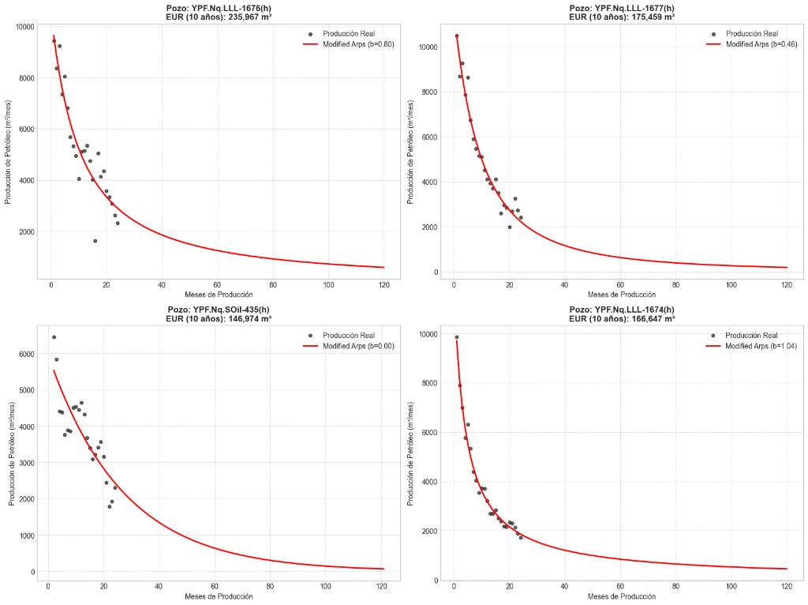

# Vaca Muerta DCA & Economics Engine

[](https://www.python.org/)
[](https://streamlit.io/)
[](https://scipy.org/)
[](https://scikit-learn.org/)
[](LICENSE)
[]()

An end-to-end quantitative engineering system for **Decline Curve Analysis (DCA)**, **Physics-Informed Reservoir Forecasting**, and **Financial Asset Valuation (NPV/Payout)** applied to unconventional horizontal wells in the **Vaca Muerta** shale play (Neuquén Basin, Argentina).

Developed from official public production datasets from the **Secretaría de Energía de la Nación (SESCO)**.

---

## 📌 Executive Summary & Problem Statement

In unconventional shale reservoirs like Vaca Muerta, fluid dynamics are dominated by transient linear flow through micro-fractures, frequently driving the Arps hyperbolic decline exponent above unity ($b > 1$). 

Standard industry evaluation methods face two critical pitfalls:
1. **Mathematical Divergence:** Integrating standard Arps equations with $b > 1$ yields infinite reserves ($\text{EUR} \to \infty$).
2. **Operational Noise & Underfitting:** Unscheduled surface interruptions (well shut-ins, plant downtime, or frac-hits) introduce extreme downward dips. Ordinary Least Squares (OLS) optimization blindly averages these operational artifacts, pulling the curve down, underpredicting initial production peaks, and collapsing to unphysical exponential curves ($b = 0$).

This project provides an automated, physics-consistent, and financially grounded computational framework to solve these challenges.

---

## 🚀 Key Features

### 1. Data Engineering Pipeline (`src/data/`)
- Automated ingestion of historical monthly production datasets from the SESCO CKAN API (>1.95 million national records).
- Strict spatial and stratigraphical filtering isolating Vaca Muerta shale plays in the Neuquina Basin (>58,000 production records across 2,359 unique horizontal wells).
- Time-zero synchronization based on first positive flowing time (`mes_relativo`) and export to optimized, compressed Apache Parquet format.

### 2. Physics-Informed Decline Modeling (`src/models/arps.py`)
- **Modified Arps:** Implements a dynamic switch point $t_{\text{switch}}$ transitioning from hyperbolic transient flow to an exponential terminal decline rate ($D_{\text{term}} = 8\%$ annual) to bound reserve integration.
- **Stretched Exponential Production Decline (SEPD):** $q(t) = q_i \exp(-(t/\tau)^n)$, a non-diverging model with rigorous physical backing for tight matrix diffusion.
- **Weighted Least Squares (WLS):** Minimizes relative error ($\sigma \propto 1/\sqrt{q}$) so that high-rate initial flow periods are preserved without being overridden by dense clouds of late-life data points.

### 3. Statistical Cleaning & Hybrid ML (`notebooks/`, `src/models/`)
- **Asymmetric Noise Filtering:** Rolling-median outlier detector specifically tailored to petroleum dynamics: preserves physical flush production peaks while filtering out artificial shut-in drops (>20% drop from local median).
- **Hybrid Machine Learning Architecture:** Decomposes forecasting into a physical macro-trend (Stretched Exponential) plus a `RandomForestRegressor` capturing high-frequency operational residuals.

### 4. Financial Valuation & Economics Engine (`src/models/economics.py`)
- Couples reservoir decline forecasts directly to business profitability using authentic Neuquén Basin market parameters:
  - **Medanito Crude Price:** $70.00 USD/bbl (export/domestic blend benchmark).
  - **Provincial Take:** 15.0% (12% Neuquén Hydrocarbon Royalty + 3% Gross Income Tax / IIBB).
  - **Lifting Cost (OPEX):** $6.00 USD/bbl.
  - **Discount Rate (WACC):** 10.0% annual (discounted monthly).
  - **CAPEX D&C:** $12M – $15M USD per horizontal multi-frac well.
- Computes **Estimated Ultimate Recovery (EUR)**, **Net Present Value (NPV)**, and **Capital Payout Timeline (ROI)**.

### 5. Interactive Analytics Web Application (`src/app/main.py`)
- Interactive dashboard built with **Streamlit** and **Plotly**.
- Filter by operator (YPF, Pan American Energy, Vista, Tecpetrol, etc.) and individual well ID.
- Real-time parameter sensitivity (Crude price, OPEX, CAPEX) with dynamic recalculation of EUR, NPV, and Payout.

---

## 📊 Visual Results

Comparison of raw production data against physics-informed fitting with operational noise mitigation:



*Figure: Automated decline curve fit on high-productivity horizontal shale wells in Vaca Muerta, demonstrating robust peak preservation and bounded tail decline.*

---

## 🏗️ Project Architecture

```text
vaca-muerta-dca/
├── assets/                  # Documentation figures and visual benchmarks
│   └── dca_results.png
├── data/
│   ├── processed/           # Processed production dataset (vaca_muerta_prod.parquet)
│   └── raw/                 # Ignored raw SESCO CSV downloads (>600 MB)
├── notebooks/               # Research, mathematical derivations & EDA
│   ├── 02_decline_models.ipynb          # Comparative fit of Arps formulations
│   ├── 03_change_points_and_ml.ipynb    # Asymmetric filter & WLS optimization
│   └── 04_ml_hybrid.ipynb               # SEPD + Random Forest on residuals
├── src/
│   ├── app/
│   │   └── main.py          # Interactive Streamlit web application
│   ├── data/
│   │   ├── download_sesco.py # API fetcher from Secretaría de Energía
│   │   └── preprocessor.py   # Transformation, filtering & Parquet serialization
│   └── models/
│       ├── arps.py          # Non-linear regression (Arps, Modified, Stretched Exp)
│       └── economics.py     # Cash-flow, NPV, and Capital Payout engine
├── tests/                   # Automated pytest suite
│   ├── test_arps.py         # Unit tests for physical decline equations
│   └── test_economics.py    # Unit tests for cash flow and NPV logic
├── .gitignore               # Strict exclusion of raw datasets and environments
├── pyproject.toml           # Package metadata and tooling config
├── requirements.txt         # Pinned reproducible dependencies
└── README.md                # Project documentation
```

---

## ⚡ Quickstart

### 1. Clone the repository
```bash
git clone https://github.com/meilantiago/vaca-muerta-dca.git
cd vaca-muerta-dca
```

### 2. Set up virtual environment
```bash
python -m venv venv

# Windows:
venv\Scripts\activate

# Linux / macOS:
source venv/bin/activate
```

### 3. Install dependencies
```bash
pip install -r requirements.txt
```

### 4. Run the automated tests
```bash
python -m pytest tests/
```
All unit tests should pass:
```text
tests\test_arps.py .....                                 [ 62%]
tests\test_economics.py ...                              [100%]
====================== 8 passed in 4.91s ======================
```

### 5. Launch the Web Dashboard
```bash
python -m streamlit run src/app/main.py
```
Open your browser at `http://localhost:8501` to explore the interactive dashboard.

---

## 👨‍💻 Author

**Tiago Meilan**  
*Physics & Scientific Computing | Quantitative Analysis & Reservoir Data Systems*

- 📍 Buenos Aires, Argentina
- 💼 [LinkedIn](https://www.linkedin.com/in/tiago-meilan-6a723a260/)
- 🐙 [GitHub](https://github.com/meilantiago)
- ✉️ [meilantiago@gmail.com](mailto:meilantiago@gmail.com)

---

## 📄 License
This project is licensed under the MIT License - see the [LICENSE](LICENSE) file for details.
